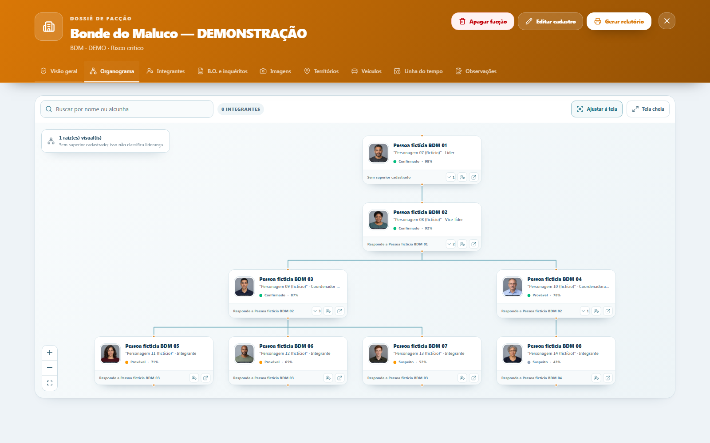

# NEXO Organograma 2.0 — Relatório das fases 1 e 2

Data da entrega: 28/10/2026
Branch: `feature/nexo-organograma-2-fase-1-2`

## 1. Resumo do que foi implementado

- Nova aba **Organograma** no dossiê de facção, preservando as demais abas.
- Canvas interativo com zoom, pan, ajuste à tela e modo tela cheia.
- Árvore vertical com ramificações claras, cartões ampliados e sem nó artificial para pessoas sem superior.
- Projeção automática dos vínculos atuais a partir de `superior_vinculo_id`.
- Todos os integrantes elegíveis aparecem, inclusive integrantes comuns.
- Pessoas sem superior válido permanecem como raízes visuais marcadas **Sem superior cadastrado**; cargo ou ausência de superior não gera classificação automática de liderança.
- Busca por nome ou alcunha com normalização de acentos, destaque, revelação de ancestrais e centralização.
- Expansão e recolhimento de ramificações.
- Cartões com fotografia existente, avatar neutro, identificação, função, status, confiança e atalhos.
- Painel lateral com organização, chefia, subordinados, fonte e acesso aos fluxos atuais de dossiê e gestão.
- Estados acessíveis de carregamento, erro e estrutura vazia.
- Proteção contra dados legados anômalos na projeção: ciclos e superiores inválidos não travam a tela nem ocultam integrantes.
- Preview local ampliado para oito personagens fictícios por organização, com três níveis e múltiplas ramificações.

O canvas é somente de visualização nesta entrega. Nenhuma movimentação visual altera chefia ou persiste dados.

## 2. Arquivos criados e modificados

Criados:

- `src/features/nexo/nexoOrganogram.ts`
- `src/features/nexo/nexoOrganogram.test.ts`
- `src/features/nexo/components/NexoOrganogram.tsx`
- `src/features/nexo/components/NexoOrganogram.test.ts`
- `docs/images/nexo-organograma-fase-1-2.png`
- especificação e plano em `docs/superpowers/`

Modificados:

- `src/features/nexo/components/NexoDossier.tsx`
- `src/features/nexo/components/NexoDossier.test.ts`
- `src/features/nexo/nexoVisual.css`
- `tests/e2e/smoke.e2e.ts`
- `package.json` e `pnpm-lock.yaml`
- `docs/roadmap-nexo.md`

## 3. Estruturas reaproveitadas

- Tipos `NexoPessoa`, `NexoVinculo` e `NexoOrganizacao`.
- Campo persistido `superior_vinculo_id`.
- Referências privadas de fotografia por `getNexoPersonPhotoUrl`.
- Callbacks do dossiê para abrir perfil e gerenciar vínculo.
- `LinkManagementDialog`, persistência atual, validação de ciclos e histórico em `nexo_hierarquia_eventos`.
- Tema visual e regras de `prefers-reduced-motion` do NEXO.
- Rota local `/preview/nexo` e dados exclusivamente sintéticos.

## 4. Banco e migrations

Nenhuma migration foi criada ou executada. As fases 1–2 usam o modelo existente e não criam infraestrutura paralela.

O replay local versionado aplicou as **122 de 122 migrations** e confirmou o schema recuperado. A migration `20261017215019_nexo_member_hierarchy.sql` continua fornecendo a coluna de chefia, validação de ciclos, trigger de histórico e RLS.

O checkout não possui projeto Supabase vinculado e a máquina não possui Docker/Podman. Portanto, a aplicação real das migrations no projeto remoto não foi verificada nem alterada.

## 5. Testes executados

| Verificação                             | Resultado                                                 |
| --------------------------------------- | --------------------------------------------------------- |
| `pnpm lint`                             | Aprovado                                                  |
| `pnpm test`                             | 75 arquivos e 531 testes aprovados                        |
| `pnpm exec tsc --noEmit`                | Aprovado                                                  |
| `pnpm build` com URL/chave local inerte | Aprovado                                                  |
| `pnpm test:bundle`                      | NEXO 675.888 bytes, abaixo do limite de 850.000           |
| `pnpm test:migrations`                  | 15 testes aprovados                                       |
| `pnpm test:schema`                      | 122/122 migrations, DDL e probes concluídos               |
| `pnpm test:schema-parity`               | 3 testes aprovados                                        |
| `pnpm test:e2e`                         | 13 testes aprovados e 3 skips previstos em viewport móvel |

O build sem variáveis locais falha de forma intencional porque o projeto exige configuração Supabase. A validação foi repetida com `http://127.0.0.1:54321` e chave placeholder, sem conexão remota.

## 6. Riscos e pendências

- Confirmar a paridade das migrations no projeto Supabase correto antes de qualquer fase com escrita.
- O build emite o aviso existente de chunk NEXO acima de 500 kB, mas o orçamento oficial do repositório foi respeitado.
- A política atual da aplicação restringe o workspace NEXO a desktop; o cenário Playwright do organograma é explicitamente ignorado no projeto móvel.
- Núcleos/setores persistidos, edição estrutural, rede não hierárquica e PDF pertencem a fases posteriores e exigem PRs próprios.
- O format check global ainda aponta arquivos preexistentes fora desta entrega; os arquivos alterados nesta branch foram formatados.

## 7. Evidência visual



A imagem usa somente o cenário local de demonstração e retratos sintéticos já versionados.

## 8. Pull Request

Link: https://github.com/harrycastielfox-ai/10V/pull/1

## 9. Como validar em localhost

```powershell
pnpm install --frozen-lockfile
$env:VITE_SUPABASE_URL = "http://127.0.0.1:54321"
$env:VITE_SUPABASE_PUBLISHABLE_KEY = "preview-local-placeholder"
pnpm dev --host 127.0.0.1 --port 4173
```

1. Abra `http://127.0.0.1:4173/preview/nexo`.
2. Entre em **Facções** e abra um dossiê demonstrativo.
3. Selecione a aba **Organograma**.
4. Teste zoom, pan, ajuste à tela, busca, seleção, recolhimento de ramo e tela cheia.
5. Confirme que **Abrir dossiê** e **Gerenciar** usam os fluxos existentes.

## 10. Próxima etapa recomendada

Abrir uma branch dependente para a fase 3 após a revisão deste PR. A fase deve especificar primeiro o modelo de núcleos/setores, permissões, confirmação de mudança de chefia, recuperação de falha de rede e auditoria, sem usar arraste como comando implícito de persistência.
